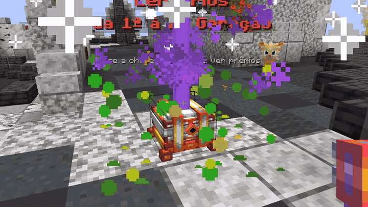
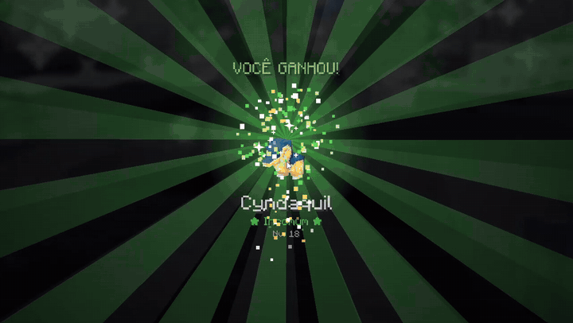
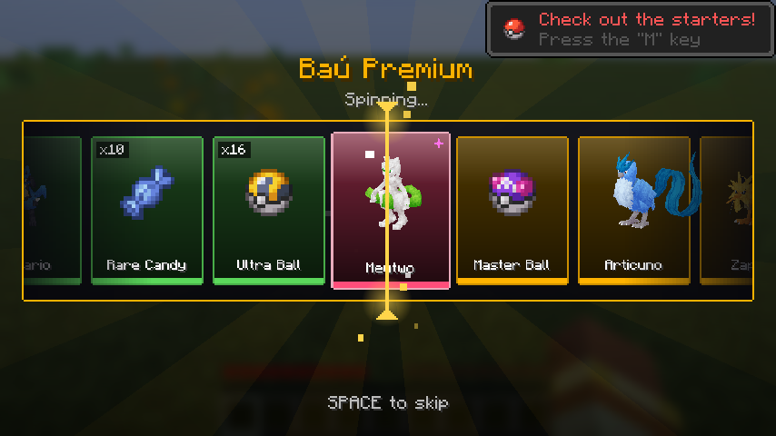
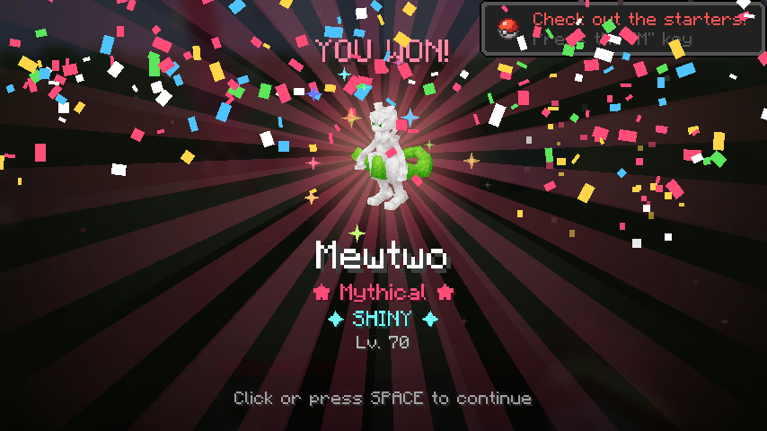
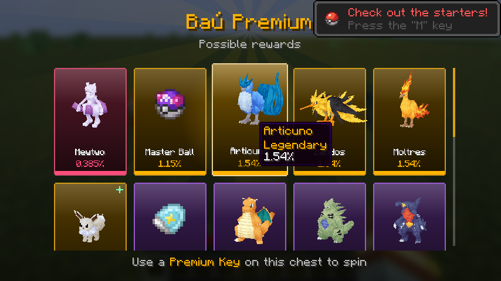
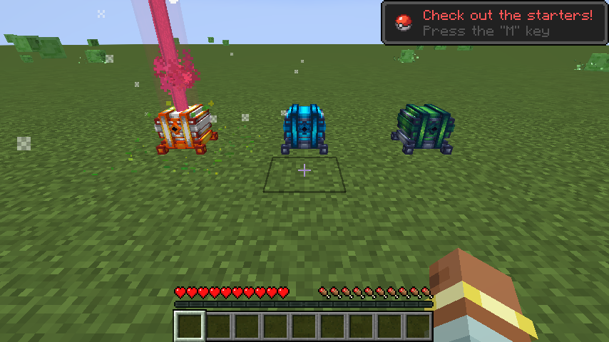

# Shifu Chests

Baús com chave para servidores de **Cobblemon** (Minecraft 1.21.1). O jogador clica no baú com a
chave e abre uma roleta animada que sorteia um Pokémon, um item ou um comando. Os prêmios, as chances
e as raridades ficam em arquivos JSON e também dá pra mexer em tudo por comando dentro do jogo.



Tem duas versões neste repositório:

| Pasta | Loader | Cobblemon | Versão | Onde roda |
|---|---|---|---|---|
| [`fabric/`](fabric) | Fabric 1.21.1 | 1.7.3+ | 2.2.1 | servidor Eclipse Cobblemon |
| [`neoforge/`](neoforge) | NeoForge 1.21.1 | 1.8.1 | 1.1.1 | modpack Galaxia Cobblemon |

Os jars prontos estão em [Releases](../../releases).

## Como funciona

- **Roleta na tela:** cartões com o modelo do Pokémon (ou o item), na cor da raridade, freando até
  parar no prêmio. Depois vem a revelação com raios de luz, faíscas, confete nos épicos pra cima,
  brilho de arco-íris quando é shiny e o grito do Pokémon.
- **Efeito no mundo pra quem está perto:** o baú treme e solta partículas enquanto gira, pula na
  revelação e, de raro pra cima, sobe um feixe de luz na cor da raridade.
- **Prévia:** clicar no baú sem a chave mostra todos os prêmios com a chance de cada um.
- **Anúncio no chat** quando alguém tira prêmio raro ou shiny.
- **Seguro pro servidor:** o sorteio acontece no servidor. Se o jogador sair no meio da roleta ou o
  servidor fechar, o prêmio é entregue na hora. Equipe cheia manda o Pokémon pro PC. Toda abertura
  fica no log.



| Roleta | Revelação |
|---|---|
|  |  |
| **Prévia dos prêmios** | **Feixe de luz no mundo** |
|  |  |

## Instalação

O mesmo jar vai no **servidor e no cliente** (pasta `mods`). Precisa do Cobblemon e do Kotlin
(Fabric Language Kotlin no Fabric, Kotlin for Forge no NeoForge), que já vêm em qualquer modpack de
Cobblemon.

Na primeira vez que o servidor abre, ele cria `config/shifuchests/` com baús de exemplo e um guia
`COMO_CONFIGURAR.txt` explicando cada campo.

## Comandos

Precisa ser operador. `/shifuchests` funciona igual ao `/baus`.

```
/baus chave <jogador> <baú> [quantidade]          dá chaves
/baus adicionar <baú> pokemon <peso> <raridade> <pokemon>
/baus adicionar <baú> item <peso> <raridade>      usa o item que está na sua mão
/baus listar <baú>                                prêmios com o número e a chance
/baus remover <baú> <número>
/baus recarregar                                  relê os JSON sem reiniciar
/baus testar <baú>                                gira sem gastar chave e sem ganhar
/baus girar <jogador> <baú>                       roleta de graça (loja, evento)
/baus previa <baú>                                qualquer jogador pode usar
```

Na versão **Fabric** o baú é qualquer bloco marcado com `/baus definir <baú>` (o ideal é o baú
dourado do Cobblemon, que abre a tampa durante a roleta), com hologramas em cima e `/baus lugares`
pra listar onde estão. Na versão **NeoForge** os baús Normal, Médio e Premium são blocos próprios do
mod, e cada JSON novo em `config/shifuchests/` vira mais um baú com a sua chave.

### Exemplo de baú

```json
{
  "nome": "Caixa de Míticos",
  "cor": "#C77DFF",
  "chave": "minecraft:tripwire_hook",
  "chance_shiny": 0,
  "nivel_padrao": "25-40",
  "recompensas": [
    { "pokemon": "pikachu", "peso": 10 },
    { "pokemon": "gible", "nivel": "10-20", "peso": 5, "raridade": "raro" },
    { "pokemon": "eevee shiny=yes", "nome": "&dEevee Shiny", "peso": 1 }
  ]
}
```

A chance de cada prêmio é `peso / soma dos pesos`. O texto do Pokémon é o mesmo do `/pokegive`.

## Compilar

Precisa de JDK 21.

```bash
cd fabric      # ou neoforge
./gradlew build
```

O jar sai em `build/libs/`. Na versão NeoForge ainda tem `gradlew runSelfTest`, que sobe um servidor
de teste com o Cobblemon e roda as verificações do sorteio e da entrega, e `gradlew runClientSelfTest`,
que abre o jogo, gira a roleta e tira os prints que estão aqui em cima.

## Créditos

- Modelos e texturas dos baús e chaves da versão NeoForge: **Chests Pack**.
- Feito pro [Cobblemon](https://cobblemon.com). Projeto de fã, sem vínculo com Cobblemon, Mojang,
  Nintendo, Game Freak ou The Pokémon Company.
